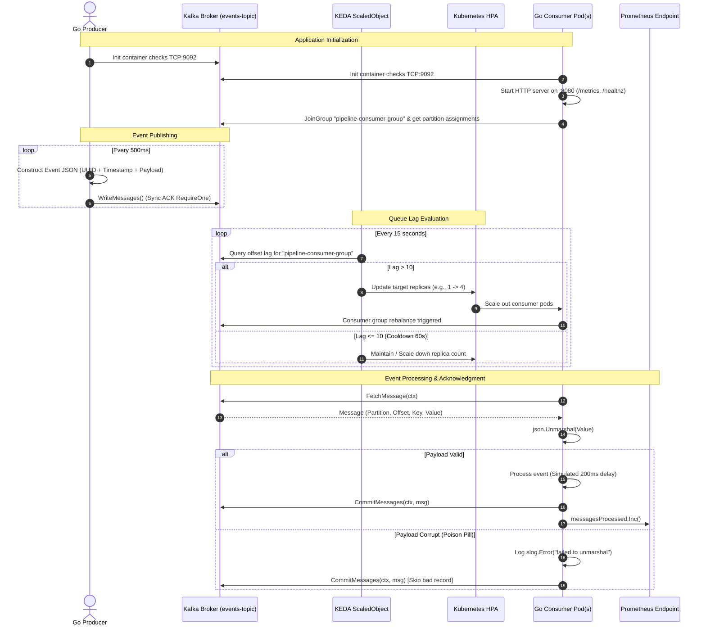

# Distributed Real-Time Event Processing Pipeline

[](https://golang.org)
[](https://kafka.apache.org)
[](https://cloud.google.com/kubernetes-engine)
[](https://keda.sh)
[](https://prometheus.io)
[](https://docker.com)

An elastic, cloud-native streaming pipeline designed to demonstrate **queue-lag-driven horizontal autoscaling**, **resilient asynchronous event ingestion**, and **end-to-end telemetry** on Kubernetes (GKE).

Built with pure Go microservices, Apache Kafka, KEDA (Kubernetes Event-driven Autoscaling), and Prometheus, this system addresses the fundamental latency pitfalls of conventional CPU-based autoscalers in event streaming architectures.

---

## Table of Contents

- [Quick Overview](#quick-overview)
- [Motivation & System Design Goals](#motivation--system-design-goals)
- [Current Implementation Status](#current-implementation-status)
- [Architecture Overview](#architecture-overview)
- [How the Project Works](#how-the-project-works)
- [Deep-Dive Technical Concepts](#deep-dive-technical-concepts)
  - [1. Queue Lag vs. CPU-Based Autoscaling](#1-queue-lag-vs-cpu-based-autoscaling)
  - [2. Delivery Semantics & Offset Commit Strategy](#2-delivery-semantics--offset-commit-strategy)
  - [3. Poison Pill Deadlock Mitigation](#3-poison-pill-deadlock-mitigation)
  - [4. Consumer Group Rebalancing Protocol](#4-consumer-group-rebalancing-protocol)
  - [5. Zero-CGo Minimal Static Containers](#5-zero-cgo-minimal-static-containers)
- [Data Flow & Payload Examples](#data-flow--payload-examples)
- [Technology Stack](#technology-stack)
- [Project Directory Structure](#project-directory-structure)
- [Prerequisites & Environment Setup](#prerequisites--environment-setup)
- [Deployment Guide](#deployment-guide)
  - [Option A: Automated Cloud Deployment (GCP / GKE)](#option-a-automated-cloud-deployment-gcp--gke)
  - [Option B: Manual Kubernetes Deployment](#option-b-manual-kubernetes-deployment)
  - [Option C: Local Development with Go](#option-c-local-development-with-go)
- [Verification & Observability](#verification--observability)
- [Configuration Reference](#configuration-reference)
- [Reliability, Cold-Starts & Hardening](#reliability-cold-starts--hardening)
- [Current Limitations](#current-limitations)
- [Future Roadmap](#future-roadmap)
- [Key Learning Outcomes](#key-learning-outcomes)
- [Technical Interview Preparation](#technical-interview-preparation)
- [Teardown & Cleanup](#teardown--cleanup)
- [License & Project Attribution](#license--project-attribution)

---

## Quick Overview

### What is this?
A distributed streaming system consisting of an event producer microservice, an Apache Kafka broker, a horizontally scalable consumer group, and an intelligent autoscaling controller running on Google Kubernetes Engine (GKE).

### What problem does it solve?
In modern microservice architectures, synchronous REST/gRPC calls create tight coupling where downstream latency or outages directly degrade upstream services. While switching to message queues decouples these services, traditional cloud infrastructure relies on **CPU or memory thresholds to scale workers**. 

In high-throughput message streaming, CPU is a **lagging indicator**: by the time worker CPU reaches 80%, thousands of unprocessed messages have piled up in the queue, causing end-to-end latency to skyrocket and violating Service Level Agreements (SLAs).

This project solves that problem by making **unconsumed Kafka topic lag** the primary scaling metric using KEDA.

```
+-----------------------------------------------------------------------------------------+
|                                    High-Level Flow                                      |
|                                                                                         |
|  [ Go Producer ]  --->  [ Apache Kafka Topic ]  --->  [ Go Consumers (1 to 10 Pods) ]    |
|   (500ms bursts)         ('events-topic')                    |                          |
|                                 ^                            |                          |
|                                 | Polls Lag (15s)            v                          |
|                          [ KEDA ScaledObject ]       [ Prometheus Metric ]              |
|                                 |                    (:8080/metrics)                    |
|                                 v                                                       |
|                     [ Kubernetes HPA Scale ]                                            |
+-----------------------------------------------------------------------------------------+
```

### Main Inputs and Outputs
- **Input:** JSON-encoded event records published to Kafka topic `events-topic` by the producer at a controlled rate (every 500ms).
- **Processing:** Consumer group instances read batches, parse JSON records, simulate business logic (200ms per message), handle malformed inputs safely, and explicitly commit partition offsets.
- **Output:** Structured `slog` execution logs per message, real-time offset advancement in Kafka, and a Prometheus counter metric (`kafka_messages_processed_total`) served over HTTP at `:8080/metrics`.

---

## Motivation & System Design Goals

| Goal | Challenge in Streaming Systems | Solution in this Architecture |
|---|---|---|
| **Asynchronous Decoupling** | Monolithic microservices stall when downstream services lag. | Persistent Kafka commit log with partition balancing. Upstream producers never wait for consumer completion. |
| **SLA-Preserving Autoscaling** | CPU utilization spikes only after queues are dangerously congested. | KEDA `ScaledObject` monitoring Kafka consumer group lag directly (`lagThreshold: 10`), triggering rapid pod scale-out. |
| **Fault Resilience** | Pod crashes or network disconnects risk dropped messages. | At-least-once processing semantics; explicit offset commits executed only *after* successful payload handling. |
| **Poison Pill Immunity** | Corrupted or schema-violating payloads can cause consumer crash loops. | Safe JSON unmarshaling with error trapping; malformed payloads are logged with partition/offset and committed past. |
| **Container Hardening** | Large Docker images increase attack surface and cold-start latency. | Multi-stage Docker builds yielding unprivileged (`UID 1000`), static Go binaries under **17 MB**. |
| **Orchestration Hygiene** | Rapid cluster initialization causes race conditions when Kafka is still booting. | Kubernetes TCP init containers (`nc -z kafka 9092`) preventing application CrashLoopBackOffs. |

---

## Current Implementation Status

This repository reflects Milestone II (Pre-Final Review, ~65% completion mark).

| Component / Feature | Description | File Reference | Status |
|---|---|---|---|
| **Go Event Producer** | Goroutine worker publishing UUID-stamped JSON events with `LeastBytes` partition balancing and OS signal shutdown. | [producer/main.go](producer/main.go) | **Complete** |
| **Go Consumer Group** | Consumer worker with manual offset commitment, payload deserialization, and poison pill recovery. | [consumer/main.go](consumer/main.go) | **Complete** |
| **Observability Server** | Native Prometheus HTTP exposition (`/metrics`) and Kubernetes liveness/readiness endpoint (`/healthz`). | [consumer/main.go](consumer/main.go#L93-L113) | **Complete** |
| **Multi-Stage Dockerfiles** | Distroless-style Alpine containers, CGO disabled, non-root user (`appuser`). | [producer/Dockerfile](producer/Dockerfile), [consumer/Dockerfile](consumer/Dockerfile) | **Complete** |
| **Kubernetes Core Manifests** | Deployments and Services for single-node Kafka, Zookeeper, Producer, and Consumer with Init Containers. | [k8s/kafka.yaml](k8s/kafka.yaml), [k8s/producer-deployment.yaml](k8s/producer-deployment.yaml), [k8s/consumer-deployment.yaml](k8s/consumer-deployment.yaml) | **Complete** |
| **KEDA Queue Autoscaler** | `ScaledObject` config targeting Kafka consumer lag with anti-flapping cooldowns. | [k8s/keda-scaledobject.yaml](k8s/keda-scaledobject.yaml) | **Complete** |
| **GCP One-Click Deployment** | Automated Bash deployment script provisioning GKE, GCR, KEDA, and workloads. | [deploy_gcp.sh](deploy_gcp.sh) | **Complete** |
| **GCP Infrastructure Teardown** | Safe deletion script removing GKE clusters and container registry assets. | [cleanup_gcp.sh](cleanup_gcp.sh) | **Complete** |
| **Presentation Deck & Scripts** | Slide decks and speaker guide for technical milestones. | [presentation.html](presentation.html), [REVIEW_PREPARATION_GUIDE.md](REVIEW_PREPARATION_GUIDE.md) | **Complete** |
| **High-Volume Load Tests** | Burst testing (500 to 2,000 msg/s) to benchmark scale-out curve. | — | *In Progress (15%)* |
| **Grafana Dashboards** | Pre-provisioned dashboards visualizing lag and replica counts. | — | *In Progress (15%)* |
| **Dead Letter Queue (DLQ)** | Dedicated Kafka topic to route rejected or invalid payloads for forensic audit. | — | *Planned (Final Milestone)* |
| **Schema Validation** | Avro or Protobuf schema validation with Confluent Schema Registry. | — | *Planned (Final Milestone)* |
| **Multi-Broker Kafka (KRaft)** | Clustered multi-broker setup without Zookeeper using KRaft consensus. | — | *Planned (Final Milestone)* |

---

## Architecture Overview

The system runs entirely within a Kubernetes cluster (tested on Google Kubernetes Engine with 3 `e2-medium` nodes).

```mermaid
flowchart TB
    subgraph KubernetesCluster ["Kubernetes Cluster (GKE / Minikube)"]
        subgraph StorageLayer ["Message Broker & Coordination"]
            ZK["Zookeeper (Port 2181)<br/>Deployment + Service"]
            KAFKA["Apache Kafka Broker (Port 9092)<br/>Deployment + Service<br/>Topic: events-topic"]
            ZK <--> KAFKA
        end

        subgraph IngestionLayer ["Ingestion Service"]
            INIT_P["Init Container<br/>(nc -z kafka 9092)"]
            PROD["Producer Pod<br/>(Go 1.21 static binary)<br/>Generates JSON every 500ms"]
            INIT_P --> PROD
            PROD -- "TCP Batch Publish<br/>LeastBytes Balancer" --> KAFKA
        end

        subgraph AutoscalingControl ["KEDA Autoscaling Engine"]
            KEDA_OP["KEDA Operator Controller<br/>Polls Kafka consumer group lag<br/>(Interval: 15s)"]
            HPA["Kubernetes Horizontal Pod Autoscaler (HPA)"]
            KEDA_OP -- "Lag > 10 Messages" --> HPA
            KAFKA -. "Consumer Group Lag Query" .- KEDA_OP
        end

        subgraph ProcessingLayer ["Consumer Group (pipeline-consumer-group)"]
            HPA -- "Scale Pods (1 to 10)" --> CONS_DEPLOY["Consumer Deployment"]
            
            subgraph PodPool ["Active Consumer Pods"]
                C1["Consumer Pod 1<br/>- FetchMessage()<br/>- Process (200ms)<br/>- CommitMessages()"]
                C2["Consumer Pod 2<br/>(Spawned on lag burst)"]
                CN["Consumer Pod N..."]
            end
            CONS_DEPLOY --> C1
            CONS_DEPLOY -.-> C2
            CONS_DEPLOY -.-> CN
            
            C1 -- "Poll & Commit" --> KAFKA
            C2 -. "Partition Claim" .-> KAFKA
            CN -. "Partition Claim" .-> KAFKA
        end

        subgraph Telemetry ["Observability Layer"]
            SVC["Consumer Service<br/>(ClusterIP: 8080)"]
            PROM["Prometheus / Metrics Scraper<br/>kafka_messages_processed_total"]
            C1 --> SVC
            C2 -.-> SVC
            SVC --> PROM
        end
    end
```



### Component Roles & Responsibilities

1. **Producer (`pipeline/producer:latest`):**
   - Implemented in [producer/main.go](producer/main.go).
   - Generates mock business events (`user_signup`, `purchase_completed`, etc.) with nanosecond-timestamped unique event IDs.
   - Uses `segmentio/kafka-go` with a 50ms batching window (`BatchTimeout`) and a `LeastBytes` partition balancing strategy to distribute load across available partitions.
   - Listens for OS interrupt signals (`SIGINT`, `SIGTERM`) to flush remaining buffered records cleanly.

2. **Broker (`confluentinc/cp-kafka:7.5.0`):**
   - Configured in [k8s/kafka.yaml](k8s/kafka.yaml).
   - Provides an append-only commit log with partition management.
   - Retains consumer group commit offsets (`__consumer_offsets`) and coordinates consumer group heartbeats.

3. **Consumer (`pipeline/consumer:latest`):**
   - Implemented in [consumer/main.go](consumer/main.go).
   - Belongs to consumer group `pipeline-consumer-group`.
   - Fetches messages via `FetchMessage`, processes them, and issues explicit commits using `CommitMessages`.
   - Hosts a concurrent HTTP server on `:8080` serving `/metrics` (Prometheus) and `/healthz` (Kubernetes probes).

4. **KEDA Controller (`keda-2.13.0`):**
   - Driven by [k8s/keda-scaledobject.yaml](k8s/keda-scaledobject.yaml).
   - Interrogates Kafka every 15 seconds to calculate the unconsumed offset lag across all partitions for `pipeline-consumer-group`.
   - Adjusts the Kubernetes Horizontal Pod Autoscaler (HPA) to scale consumer replicas up to 10 when lag exceeds 10 messages, and scales down after a 60-second cooldown period.

---

## How the Project Works

Here is the exact lifecycle of an event moving through the system:



### Step-by-Step Execution Flow

1. **Bootstrap & Health Initialization:**
   - Pods start on GKE. The init containers (`busybox:1.36`) run `until nc -z kafka 9092; do sleep 3; done` to guarantee Kafka is accepting TCP sockets.
   - Once ready, the consumer binary launches. It starts a background HTTP listener on `:8080` exposing `/healthz` for Kubernetes readiness probes and `/metrics` for Prometheus.
   - The consumer joins `pipeline-consumer-group` and receives its assigned partition(s).

2. **Publishing (Ingestion):**
   - The producer's internal ticker fires every 500ms.
   - It constructs an `Event` struct with a unique identifier (`evt-<unix_nano>-<random_hex>`), a UTC RFC3339 timestamp, and a random mock business event string.
   - The event is serialized to JSON and pushed to Kafka via `writer.WriteMessages()`.

3. **Buffering & Queue Observation:**
   - Kafka writes the record to the append-only commit log for `events-topic`.
   - If message generation outpaces consumer processing (e.g., during bursts), messages accumulate.
   - Every 15 seconds, KEDA queries Kafka's broker API to compare the high-watermark offset against the current consumer group offset.

4. **Dynamic Elastic Scaling:**
   - If the total backlog divided across active workers exceeds `10`, KEDA instructs the Kubernetes HPA to increment the replica count (up to 10).
   - New consumer pods initialize, register with the Kafka group coordinator, trigger a consumer group rebalance, and begin processing partitions in parallel.

5. **Processing & Safe Commit:**
   - Workers use `FetchMessage()` to retrieve the next available batch.
   - The message payload is parsed. If parsing succeeds, the worker processes the record (simulated 200ms workload) and explicitly commits the offset (`CommitMessages`).
   - The atomic Prometheus counter `kafka_messages_processed_total` increments by 1.

6. **Graceful Teardown:**
   - On pod termination (`SIGTERM`), the signal handler cancels the Go `context.Context`.
   - The consumer completes its current in-flight message, terminates the fetch loop, shuts down the HTTP server within a 5-second deadline, and closes the Kafka reader, releasing its partition lock cleanly.

---

## Deep-Dive Technical Concepts

### 1. Queue Lag vs. CPU-Based Autoscaling

Standard Kubernetes autoscaling depends on the Horizontal Pod Autoscaler (HPA) monitoring CPU or RAM utilization via the `metrics-server`. 

```
Conventional CPU Autoscaling Failure Mode:
Event Burst Arrives ────────► Kafka Queue Depth Explodes ────► Consumer Buffers Network Packets
                                                                          │
  SLA Violated (High Latency) ◄─── Pods Scale Up (Too Late!) ◄─── CPU Utilization Finally Spikes
```

- **Why CPU fails for messaging:** A Go network worker efficiently waiting on I/O or processing small payloads might consume negligible CPU (5–15%), even while thousands of unread messages back up in Kafka. By the time CPU climbs to 80%, end-to-end processing latency has already ballooned from milliseconds to minutes.
- **How KEDA solves this:** KEDA acts as an external metrics provider. It queries Kafka directly using the broker's offset metadata:
  $$\text{Lag} = \text{LogEndOffset (High Watermark)} - \text{ConsumerOffset}$$
  When $\text{Lag} > 10$, KEDA immediately triggers pod provisioning *before* CPU spikes or system memory is exhausted.

### 2. Delivery Semantics & Offset Commit Strategy

Messaging systems support three delivery models: *at-most-once*, *at-least-once*, and *exactly-once*.

This pipeline implements **At-Least-Once** delivery:
- **No Auto-Commit:** In [consumer/main.go](consumer/main.go#L76), auto-commit is disabled in favor of explicit manual acknowledgement.
- **Commit After Processing:** Offsets are committed only after business logic completes:
  ```go
  // 1. Fetch message from Kafka buffer
  msg, err := reader.FetchMessage(ctx)
  
  // 2. Execute business processing
  time.Sleep(200 * time.Millisecond)
  
  // 3. Persist progress to Kafka commit log
  reader.CommitMessages(ctx, msg)
  ```
- **Crash Recovery:** If a consumer pod experiences an unhandled panic, hardware fault, or node eviction mid-execution, the offset is never written to Kafka. When the group coordinator reassigns the partition to another healthy consumer, the message is refetched and processed. Downstream deduplication can be enforced idempotently using the unique `event.ID`.

### 3. Poison Pill Deadlock Mitigation

A **poison pill** is a malformed message (corrupt bytes, schema incompatibility, truncated payload) that cannot be parsed by consumer logic. In naive consumers that retry on error, the consumer crashes or restarts, refetches the identical uncommitted message from the same offset, and enters an infinite crash-and-fail loop:

```
[ Poison Pill Record ] ───> json.Unmarshal() Fails ───> Return Error ───> Message Not Committed
       ▲                                                                            │
       └──────────────────────── Pod Restarts & Refetches ──────────────────────────┘
```

**Implementation in this pipeline:**
In [consumer/main.go](consumer/main.go#L152-L163), when `json.Unmarshal` returns an error, the consumer logs an alert with the exact partition and offset, but **explicitly commits the offset forward**:
```go
if err := json.Unmarshal(msg.Value, &event); err != nil {
    slog.Error("failed to unmarshal event",
        "error", err,
        "partition", msg.Partition,
        "offset", msg.Offset,
    )
    // Commit bad message to avoid infinite pipeline blockage
    if commitErr := reader.CommitMessages(ctx, msg); commitErr != nil {
        slog.Error("failed to commit bad message", "error", commitErr)
    }
    continue
}
```
*Note: In the final milestone, these skipped messages will be forwarded to a dedicated Dead Letter Queue (DLQ) topic for auditing.*

### 4. Consumer Group Rebalancing Protocol

Kafka manages parallelism across partitions through consumer groups:
- All consumer replicas declare `GroupID: "pipeline-consumer-group"`.
- When KEDA scales the consumer deployment from 1 replica to $N$ replicas, each new pod registers with the Kafka Group Coordinator broker.
- Kafka initiates a **group rebalance**. In modern Kafka, this uses cooperative sticky assignment to reallocate partition leases with minimal downtime.
- If a topic has 5 partitions and KEDA scales out to 5 pods, each pod consumes exactly 1 partition concurrently, achieving linear horizontal scalability.

### 5. Zero-CGo Minimal Static Containers

Standard Go Kafka clients (such as `confluent-kafka-go`) rely on CGo wrappers around the C library `librdkafka`. 
- **Drawbacks of CGo:** Requires GCC/musl compilation in the Docker builder, inflates build time, increases memory footprints, and creates dynamic linking dependencies that make scratching images difficult.
- **The pure-Go approach:** This project uses `segmentio/kafka-go`. Compiling with:
  ```bash
  CGO_ENABLED=0 GOOS=linux GOARCH=amd64 go build -ldflags="-s -w" -o /consumer .
  ```
  strips the symbol table and debug information (`-s -w`), creating a completely static, standalone ELF binary.
- **Security hardening:** Running on `alpine:3.19` under an explicit non-root user (`appuser`, UID `1000`) reduces the container attack surface and produces an image under **17 MB** with zero OS-level dependencies.

---

## Data Flow & Payload Examples

### Event Payload Structure

Events produced by [producer/main.go](producer/main.go) follow this JSON schema:

```json
{
  "id": "evt-1719142852123456789-3a7f",
  "timestamp": "2026-10-23T14:07:32.123456789Z",
  "data": "purchase_completed"
}
```

- `id`: Deterministic unique identifier combining Unix nanoseconds and 4 hex random digits (`fmt.Sprintf("evt-%d-%04x", time.Now().UnixNano(), rand.Intn(0xFFFF))`).
- `timestamp`: High-precision UTC timestamp formatted in ISO 8601 / RFC 3339 Nano.
- `data`: Simulated domain event selected randomly from:
  `user_signup`, `page_view`, `purchase_completed`, `item_added_to_cart`, `session_started`, `notification_sent`, `password_reset`, `profile_updated`, `search_query`, `file_uploaded`.

### Representative Consumer Execution Log

The consumer produces structured JSON logs using Go's standard `log/slog` library:

```json
{"time":"2026-10-23T14:07:32.345Z","level":"INFO","msg":"starting consumer","brokers":["kafka:9092"],"topic":"events-topic","group_id":"pipeline-consumer-group","metrics_addr":":8080"}
{"time":"2026-10-23T14:07:32.346Z","level":"INFO","msg":"metrics server starting","addr":":8080"}
{"time":"2026-10-23T14:07:32.551Z","level":"INFO","msg":"message processed","id":"evt-1719142852123456789-3a7f","data":"purchase_completed","partition":0,"offset":142}
{"time":"2026-10-23T14:07:32.756Z","level":"INFO","msg":"message processed","id":"evt-1719142852128912345-8b1c","data":"user_signup","partition":0,"offset":143}
```

### Representative Prometheus Metrics Output

Querying `http://localhost:8080/metrics` exposes the standard Go runtime metrics alongside the custom pipeline counter:

```prometheus
# HELP kafka_messages_processed_total Total number of Kafka messages successfully processed by the consumer.
# TYPE kafka_messages_processed_total counter
kafka_messages_processed_total 144
```

---

## Technology Stack

| Technology | Layer | Version | Rationale & Purpose in this Project |
|---|---|---|---|
| **Go (Golang)** | Microservices | 1.21 | Minimal memory footprint (~15 MB RAM per pod vs. 300+ MB for Java), fast cold starts (<100ms), lightweight goroutine concurrency. |
| **segmentio/kafka-go** | Kafka Driver | v0.4.47 | Pure Go Kafka library. Eliminates CGo and `librdkafka` build dependencies, enabling single-binary static linking. |
| **Apache Kafka** | Message Broker | 7.5.0 (Confluent) | High-throughput distributed commit log, partitioned topics, and offset management. |
| **Apache Zookeeper** | Coordination | 7.5.0 (Confluent) | Maintains cluster state and consensus for the single-node dev Kafka broker. |
| **KEDA** | Autoscaler | v2.13.0 | CNCF event-driven autoscaler. Connects directly to Kafka to scale Kubernetes deployments based on consumer lag. |
| **Kubernetes (GKE)** | Orchestration | 1.28+ | Manages container lifecycle, self-healing pod restarts, internal DNS networking, and cluster scalability. |
| **Prometheus Client** | Telemetry | v1.19.0 | Exposes application-level metrics (`kafka_messages_processed_total`) over HTTP for scraping. |
| **Docker / Alpine** | Containerization | Alpine 3.19 | Multi-stage build process resulting in an attack-minimized, non-root runtime image under 17 MB. |
| **Google Cloud (GCR / GKE)** | Cloud Platform | — | Hosted environment providing managed compute nodes and private container registry infrastructure. |

---

## Project Directory Structure

```
kafka-event-pipeline/
├── cleanup_gcp.sh               # Shell script: tears down GKE cluster, k8s resources, and GCR images
├── deploy_gcp.sh                # Shell script: end-to-end GKE provisioner and deployment orchestrator
├── presentation.html            # Interactive slide presentation for academic / technical reviews
├── presentation_print.html      # Printable 16:9 PDF export version of presentation
├── REVIEW_PREPARATION_GUIDE.md  # Detailed speaker guide, slide talking points, and reviewer Q&A notes
│
├── consumer/                    # Consumer Microservice (Go)
│   ├── Dockerfile               # Multi-stage Alpine container build with non-root appuser
│   ├── go.mod                   # Go module definitions (segmentio/kafka-go, prometheus/client_golang)
│   └── main.go                  # Consumer group logic, offset commit loop, and HTTP metrics server
│
├── producer/                    # Producer Microservice (Go)
│   ├── Dockerfile               # Multi-stage Alpine container build with non-root appuser
│   ├── go.mod                   # Go module definitions (segmentio/kafka-go)
│   └── main.go                  # Event generator, LeastBytes partition balancer, signal trap
│
└── k8s/                         # Declarative Kubernetes Manifests
    ├── kafka.yaml               # Single-node Zookeeper & Kafka broker Deployments and Headless Services
    ├── producer-deployment.yaml # Producer Deployment with TCP init container (nc -z kafka 9092)
    ├── consumer-deployment.yaml # Consumer Deployment & ClusterIP Service with Prometheus annotations
    └── keda-scaledobject.yaml   # KEDA Autoscaling definition (lagThreshold: 10, cooldown: 60s)
```

---

## Prerequisites & Environment Setup

### Required Tools
Depending on where you plan to run or test the pipeline:

| Tool | Minimum Version | Purpose |
|---|---|---|
| **Go Runtime** | `1.21+` | Local binary compilation and testing. |
| **Docker Engine** | `20.10+` | Container image building. |
| **kubectl** | `v1.26+` | Kubernetes cluster management. |
| **gcloud CLI** | Latest | Interacting with Google Cloud Engine / GKE (if deploying to cloud). |
| **Minikube / Kind** | Latest | Optional local Kubernetes cluster for desktop testing. |

---

## Deployment Guide

### Option A: Automated Cloud Deployment (GCP / GKE)

The easiest way to run the entire pipeline in the cloud is using the provided one-click deployment script in Google Cloud Shell.

1. **Open Google Cloud Shell:**
   Navigate to [console.cloud.google.com](https://console.cloud.google.com) and click the `>_` Cloud Shell icon.

2. **Clone the Repository & Set Project:**
   ```bash
   git clone https://github.com/vaibhavxps/kafka-event-pipeline.git
   cd kafka-event-pipeline
   gcloud config set project YOUR_PROJECT_ID
   ```

3. **Execute the Deployment Script:**
   ```bash
   bash deploy_gcp.sh
   ```

   **What `deploy_gcp.sh` executes automatically:**
   - Enables GCP Container (`container.googleapis.com`) and Container Registry (`containerregistry.googleapis.com`) APIs.
   - Configures Docker authentication for Google Container Registry (`gcr.io`).
   - Builds both Go microservices and pushes `gcr.io/$PROJECT_ID/producer:latest` and `consumer:latest`.
   - Provisions a 3-node GKE cluster (`kafka-pipeline-cluster`, machine type `e2-medium`, zone `us-central1-a`).
   - Configures `kubectl` context to point to the new cluster.
   - Deploys Zookeeper and Kafka; waits for them to be healthy.
   - Deploys the Producer and Consumer pods.
   - Installs the official KEDA operator (`v2.13.0`) via server-side apply.
   - Applies the KEDA `ScaledObject` to activate lag-based autoscaling.

---

### Option B: Manual Kubernetes Deployment

If you are running on an existing Kubernetes cluster (such as a local Minikube cluster or an existing GKE/EKS cluster):

1. **Build and Tag Images Locally:**
   ```bash
   # From repository root
   docker build -t pipeline/producer:latest ./producer
   docker build -t pipeline/consumer:latest ./consumer
   ```
   *(If using Minikube, run `eval $(minikube docker-env)` first so Minikube can see your local Docker daemon).*

2. **Deploy Kafka & Zookeeper:**
   ```bash
   kubectl apply -f k8s/kafka.yaml
   
   # Wait for broker availability
   kubectl wait --for=condition=ready pod -l app=zookeeper --timeout=180s
   kubectl wait --for=condition=ready pod -l app=kafka --timeout=180s
   ```

3. **Deploy Applications:**
   ```bash
   kubectl apply -f k8s/producer-deployment.yaml
   kubectl apply -f k8s/consumer-deployment.yaml
   ```

4. **Install KEDA & Apply ScaledObject:**
   ```bash
   # Install KEDA operator v2.13.0
   kubectl apply --server-side -f https://github.com/kedacore/keda/releases/download/v2.13.0/keda-2.13.0.yaml
   
   # Wait for KEDA pods to initialize
   kubectl wait --for=condition=ready pod -l app.kubernetes.io/part-of=keda-operator -n keda --timeout=120s
   
   # Apply Autoscaler
   kubectl apply -f k8s/keda-scaledobject.yaml
   ```

---

### Option C: Local Development with Go

To test microservices locally without Kubernetes:

1. **Start a Local Kafka Broker:**
   Using Docker:
   ```bash
   docker run -d --name zookeeper -p 2181:2181 -e ZOOKEEPER_CLIENT_PORT=2181 confluentinc/cp-zookeeper:7.5.0
   docker run -d --name kafka -p 9092:9092 \
     -e KAFKA_ZOOKEEPER_CONNECT=localhost:2181 \
     -e KAFKA_ADVERTISED_LISTENERS=PLAINTEXT://localhost:9092 \
     -e KAFKA_OFFSETS_TOPIC_REPLICATION_FACTOR=1 \
     -e KAFKA_AUTO_CREATE_TOPICS_ENABLE=true \
     confluentinc/cp-kafka:7.5.0
   ```

2. **Run Consumer:**
   ```bash
   cd consumer
   export KAFKA_BROKERS="localhost:9092"
   export KAFKA_TOPIC="events-topic"
   export KAFKA_GROUP_ID="local-test-group"
   export METRICS_ADDR=":8080"
   go run main.go
   ```

3. **Run Producer (in another terminal):**
   ```bash
   cd producer
   export KAFKA_BROKERS="localhost:9092"
   export KAFKA_TOPIC="events-topic"
   go run main.go
   ```

---

## Verification & Observability

### 1. Monitor Cluster Pod Status
Ensure all components are running without crash loops:
```bash
kubectl get pods -w
```
Expected output:
```
NAME                        READY   STATUS    RESTARTS   AGE
zookeeper-547565787d-89x2v   1/1     Running   0          5m
kafka-69d6798bf-w2pl9       1/1     Running   0          4m
producer-57cd557bd-kj9d2    1/1     Running   0          3m
consumer-84c47fb9bf-72b1a   1/1     Running   0          3m
```

### 2. Inspect Producer & Consumer Logs
Stream live event production:
```bash
kubectl logs -f deploy/producer --tail=10
```

Stream live consumer acknowledgements:
```bash
kubectl logs -f deploy/consumer --tail=10
```

### 3. Verify KEDA Autoscaling Status
Check the status of KEDA's `ScaledObject` and the auto-generated HPA:
```bash
kubectl get scaledobject,hpa
```
Expected output:
```
NAME                                               SCALETARGETKIND   SCALETARGETNAME   MIN   MAX   TRIGGERS   AUTHENTICATION   READY   ACTIVE   AGE
scaledobject.keda.sh/consumer-scaledobject         Deployment        consumer          1     10    kafka                       True    True     5m

NAME                                                  REFERENCE             TARGETS       MINPODS   MAXPODS   REPLICAS   AGE
horizontalpodautoscaler.autoscaling/keda-hpa-consumer-scaledobject   Deployment/consumer   0/10 (avg)    1         10        1          5m
```

### 4. Inspect Prometheus Metrics
Forward the consumer service metrics port to your local machine:
```bash
kubectl port-forward svc/consumer 8080:8080
```
Open a browser or run `curl`:
```bash
curl http://localhost:8080/metrics | grep kafka_messages_processed_total
```
Output:
```prometheus
# HELP kafka_messages_processed_total Total number of Kafka messages successfully processed by the consumer.
# TYPE kafka_messages_processed_total counter
kafka_messages_processed_total 87
```

---

## Configuration Reference

Both microservices and the autoscaler are configured via environment variables and declarative YAML fields:

### Producer Configuration

| Environment Variable | Default Value | Description |
|---|---|---|
| `KAFKA_BROKERS` | `localhost:9092` | Comma-separated list of Kafka broker host:port addresses. |
| `KAFKA_TOPIC` | `events-topic` | Destination Kafka topic name. |

### Consumer Configuration

| Environment Variable | Default Value | Description |
|---|---|---|
| `KAFKA_BROKERS` | `localhost:9092` | Comma-separated list of Kafka broker host:port addresses. |
| `KAFKA_TOPIC` | `events-topic` | Source Kafka topic name. |
| `KAFKA_GROUP_ID` | `pipeline-consumer-group` | Consumer group ID for coordinated partition consumption and offset tracking. |
| `METRICS_ADDR` | `:8080` | TCP address and port binding for HTTP `/metrics` and `/healthz`. |

### KEDA ScaledObject Parameters ([k8s/keda-scaledobject.yaml](k8s/keda-scaledobject.yaml))

| Field | Configured Value | Explanation |
|---|---|---|
| `pollingInterval` | `15` | Seconds between consecutive lag queries to the Kafka broker. |
| `cooldownPeriod` | `60` | Wait period in seconds before scaling down after lag drops below threshold (prevents thrashing). |
| `minReplicaCount` | `1` | Ensures at least one consumer pod remains warm to process baseline traffic. |
| `maxReplicaCount` | `10` | Upper bound ceiling on consumer replicas to prevent cluster resource starvation. |
| `lagThreshold` | `10` | Total unconsumed messages across partitions needed to trigger an additional pod replica. |
| `offsetResetPolicy` | `earliest` | Fallback behavior when reading new or uncommitted partitions. |

---

## Reliability, Cold-Starts & Hardening

### 1. Eliminating Pod Boot Race Conditions
Kafka takes approximately 20–35 seconds to bootstrap its JVM and connect to Zookeeper. In standard Kubernetes deployments, lightweight Go microservices boot in under 50ms and immediately crash because the TCP port `9092` is not open, triggering `CrashLoopBackOff`.

Both [k8s/producer-deployment.yaml](k8s/producer-deployment.yaml) and [k8s/consumer-deployment.yaml](k8s/consumer-deployment.yaml) resolve this by specifying an `initContainers` block:
```yaml
initContainers:
  - name: wait-for-kafka
    image: busybox:1.36
    command:
      - sh
      - -c
      - |
        echo "Waiting for Kafka to be ready..."
        until nc -z kafka 9092; do
          echo "Kafka not ready yet, retrying in 3s..."
          sleep 3
        done
        echo "Kafka is ready!"
```

### 2. Autoscaler Thrashing / Flapping Prevention
When an event burst occurs, lag increases and KEDA immediately provisions additional pods. Once the new pods consume the backlog, the lag drops to zero. If scale-down is immediate, Kubernetes kills the pods, only to recreate them when the next burst hits (flapping). 
The `cooldownPeriod: 60` setting ensures that scaled pods remain alive for at least 1 minute after lag clears to absorb trailing load smoothly.

### 3. Container Security Hardening
- **Non-Root Execution:** The Dockerfiles declare `RUN adduser -D -u 1000 appuser` and switch execution with `USER appuser`. If an attacker exploits a code vulnerability, they have unprivileged access within an isolated container filesystem.
- **Resource Limits:** Both producer and consumer deployments define strict CPU requests (`100m`) and limits (`250m`), as well as memory requests (`64Mi`) and limits (`128Mi`), preventing any single rogue goroutine or memory leak from starving node resources.

---

## Current Limitations

To maintain architectural honesty, the following constraints in the current implementation are noted:

1. **Single-Broker Kafka Topology:** The Kafka deployment runs as a single replica (`replicas: 1`) using an ephemeral pod disk. If the Kafka pod restarts, buffered messages are retained only if persisted within container life. Production deployments require a multi-broker StatefulSet with persistent volume claims (PVCs) and partition replication factor $\ge 3$.
2. **Synchronous In-Memory Sink:** The consumer logs messages and increments a Prometheus counter; it does not currently write to an external database (e.g., PostgreSQL, Elasticsearch, or ClickHouse).
3. **No Dead Letter Queue (DLQ) Routing:** Invalid JSON records are logged and committed past to avoid pipeline starvation, but are not yet forwarded to a secondary DLQ Kafka topic for post-mortem analysis.
4. **Static Ingestion Rate:** The current producer emits events at fixed 500ms intervals. Load spike testing currently requires either deploying multiple producer pods or running external load injection scripts.

---

## Future Roadmap

The remaining 35% of the project scope scheduled for the final milestone includes:

- [ ] **High-Volume Load Benchmarking:** Script automated burst tests (500 to 2,000 events/second) using a headless load generator to capture empirical scale-out response times and recovery curves.
- [ ] **Dead Letter Queue (DLQ) Topic:** Automatically redirect malformed payloads to an `events-dlq` topic with diagnostic headers containing error reasons and timestamps.
- [ ] **Distributed Deduplication Layer:** Introduce a Redis cache to store event UUIDs for 24 hours, achieving end-to-end idempotent processing.
- [ ] **Grafana Dashboard Integration:** Provide pre-built Grafana Helm charts visualizing real-time consumer lag, pod counts, and processing throughput per second.
- [ ] **KRaft Consensus Migration:** Upgrade Kafka configuration to run in modern KRaft (Kafka Raft Metadata) mode, eliminating the Zookeeper dependency entirely.

---

## Key Learning Outcomes

Exploring and running this codebase demonstrates several foundational distributed systems and cloud-native concepts:

1. **Event-Driven Architecture vs. Synchronous REST:** Understanding how persistent commit logs decouple microservice execution timelines and prevent cascading outages.
2. **Cloud-Native Autoscaling Internals:** Hands-on experience with how Kubernetes Custom Resource Definitions (CRDs) like KEDA `ScaledObject` communicate with the External Metrics API to control HPAs.
3. **Low-Level Concurrency in Go:** Writing production-grade Go services utilizing goroutines, thread-safe atomic counters, OS signal channels, and context cancellation deadlines.
4. **Systems-Level Kafka Mechanics:** Working directly with consumer groups, partition balancing algorithms, commit offsets, and rebalance storms.
5. **Production Kubernetes Deployment:** Writing resilient manifests featuring TCP init containers, health probes, resource quotas, and multi-stage container security.

<!--

## Technical Interview Preparation

Here are ten realistic technical interview questions grounded directly in this repository's implementation, complete with concise model answers:

#### Q1: Why did you scale based on Kafka queue lag rather than CPU or Memory utilization?
> **Answer:** In streaming pipelines, CPU is a lagging indicator. A Go consumer pod can buffer thousands of unconsumed messages in network sockets or channel buffers with minimal CPU overhead (~10%). By the time the Kubernetes HPA registers high CPU and schedules new pods, downstream SLAs are already broken. KEDA queries Kafka directly for consumer group lag ($\text{LogEndOffset} - \text{CurrentOffset}$), triggering scaling proactively the moment backlog begins to form.

#### Q2: What delivery guarantees does your pipeline provide, and how are duplicate messages handled?
> **Answer:** The pipeline provides **At-Least-Once** processing. We disable auto-commit and call `reader.CommitMessages()` only *after* the payload is deserialized and processed. If a pod crashes mid-execution, the uncommitted message is reassigned to another consumer. While this prevents message loss, it introduces potential duplicates. To achieve end-to-end idempotency, downstream sinks must record the unique `event.ID` in a deduplication store (e.g., Redis or an SQL unique constraint).

#### Q3: How does Kafka partition rebalancing behave when KEDA scales the consumer deployment from 1 to 5 replicas?
> **Answer:** All consumer pods share the group ID `pipeline-consumer-group`. When KEDA scales out the deployment, each new pod registers with the Kafka Group Coordinator broker. Kafka initiates a group rebalance protocol, recalculating partition ownership and reassigning topic partitions evenly among the active pods. If the topic has 5 partitions, each consumer pod receives exactly 1 partition.

#### Q4: What is a "poison pill" message and how does your consumer prevent it from halting the pipeline?
> **Answer:** A poison pill is an unprocessable or malformed message (e.g., corrupted JSON). In naive systems, deserialization failure returns an error without committing the offset, causing the consumer to restart, refetch the same message, and crash in an infinite loop. In [consumer/main.go](consumer/main.go#L152-L162), we catch `json.Unmarshal` errors, log them with partition and offset metadata, and call `CommitMessages()` to skip the bad record and keep the pipeline moving.

#### Q5: Why did you choose `segmentio/kafka-go` over `confluent-kafka-go`?
> **Answer:** `confluent-kafka-go` is a CGo wrapper around `librdkafka`. Compiling CGo requires a C compiler (GCC/musl), complicates cross-compilation, slows down Docker builds, and makes creating minimal static binaries difficult. `segmentio/kafka-go` is written in 100% pure Go, allowing us to build a completely static binary (`CGO_ENABLED=0`) and run it in a lightweight Alpine container under 17 MB.

#### Q6: How do you handle cold-start race conditions in Kubernetes when the cluster boots?
> **Answer:** Kafka takes ~30 seconds to initialize its JVM and connect to Zookeeper, whereas Go binaries launch in milliseconds. To prevent the producer and consumer pods from failing and entering `CrashLoopBackOff`, we attach a BusyBox init container running `until nc -z kafka 9092; do sleep 3; done`. The main application container only starts after port 9092 is actively accepting TCP connections.

#### Q7: What is the purpose of the 60-second cooldown period in the KEDA `ScaledObject`?
> **Answer:** The cooldown period prevents **autoscaler flapping** (rapid oscillation between scaling up and down). When a burst of events is cleared, lag drops to zero. Without a cooldown period, Kubernetes would immediately terminate excess pods, only to restart them seconds later when the next burst arrives. A 60-second cooldown keeps warm pods alive to absorb near-term traffic.

#### Q8: How is observability implemented in the consumer microservice?
> **Answer:** In [consumer/main.go](consumer/main.go), we register a Prometheus Counter `kafka_messages_processed_total` and run a concurrent HTTP server on `:8080` using `promhttp.Handler()`. The Kubernetes service is annotated with `prometheus.io/scrape: "true"`, allowing any standard Prometheus server to automatically discover and scrape pod metrics. We also expose `/healthz` for Kubernetes liveness/readiness probes.

#### Q9: How are graceful shutdowns handled when Kubernetes sends a `SIGTERM`?
> **Answer:** In both microservices, we listen on an OS signal channel (`syscall.SIGINT`, `syscall.SIGTERM`). When Kubernetes sends a termination notice, the signal cancels a parent Go `context.Context`. The producer flushes buffered messages and closes the Kafka writer. The consumer finishes its current message, cleanly closes the HTTP server with a 5-second timeout, and closes the Kafka reader to release its partition locks immediately.

#### Q10: What infrastructure trade-offs were made between this milestone and a production deployment?
> **Answer:** This milestone prioritizes minimal cost and resource efficiency for demonstration: it uses a single-broker Kafka deployment without persistent volume claims, runs Zookeeper instead of KRaft, simulates processing using `time.Sleep`, and commits bad records past instead of routing them to a Dead Letter Queue (DLQ). A production-grade deployment would implement a 3-broker KRaft StatefulSet, persistent NVMe storage, schema validation via Schema Registry, and DLQ topic routing.

-->

## Teardown & Cleanup

To avoid ongoing billing charges on Google Cloud Platform, run the cleanup script from Cloud Shell:

```bash
bash cleanup_gcp.sh
```

**What the cleanup script deletes:**
- Deletes all active Kubernetes deployments and services.
- Deletes the GKE cluster (`kafka-pipeline-cluster`).
- Deletes container images stored in Google Container Registry (`gcr.io/$PROJECT_ID/producer` and `consumer`).

---

## License & Project Attribution

This project was developed by **Vaibhav** as part of the Master of Computer Applications (MCA) curriculum under the academic guidance of **Dr. Micheal Arok**.

- **Repository:** [vaibhavxps/kafka-event-pipeline](https://github.com/vaibhavxps/kafka-event-pipeline)
- **Status:** Second-Last Project Review (Milestone II — ~65% Progress)
- **Review Assets:**
  - [Interactive Slide Deck](presentation.html)
  - [Reviewer Preparation & Script Guide](REVIEW_PREPARATION_GUIDE.md)
